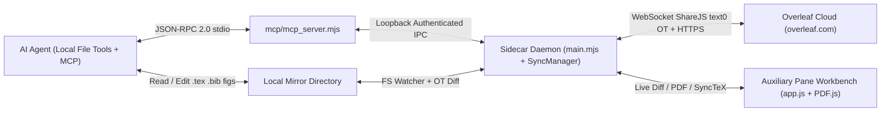

<p align="center">
  
</p>

<h1 align="center">Overleaf Live</h1>

<p align="center">
  <strong>Real-time Overleaf LaTeX collaboration plugin for AI coding agents — ShareJS OT bidirectional mirror, cloud TeX Live compilation, SyncTeX navigation, MCP server, and live side-pane workbench.</strong>
</p>

<p align="center">
  
  
  
  
</p>

---

## Overview

**Overleaf Live** bridges local AI coding agents (via **Model Context Protocol**) directly to live **Overleaf** (`overleaf.com`) projects without requiring a paid Git Bridge subscription or leaving your IDE. Agents read and edit a local filesystem mirror using normal file tools; every change is converted into incremental ShareJS `text0` Operational Transformation (OT) operations, synced in real time with remote collaborators, compiled on Overleaf's cloud TeX Live backend, and rendered side-by-side with **bidirectional SyncTeX** in the Auxiliary Pane workbench.

> **中文简介**：原生集成在 Agent Harness 中的本地 Overleaf 实时协作插件（Sidecar 辅助侧栏 + MCP 协同工具）。兼容 Overleaf 免费账号（无需 Git Bridge），让 Agent 直接在本地镜像目录读写 `.tex` / `.bib` / 图片资源，秒级转为 ShareJS OT 增量同步至云端，并提供可编辑源码、实时 Diff、云端 TeX Live 编译闭环与 SyncTeX 正反向精准定位。

## Architecture



## Key Features

- **Zero-Paid-Plan Real-Time Bidirectional Sync**: Converts local edits and remote collaborator edits via incremental ShareJS `text0` OT updates (`lib/ot_diff.mjs`, `lib/sync_manager.mjs`)—no paid Overleaf Git Bridge required.
- **Dual-Channel Local Session Auth**: Supports pasting browser session cookies (`overleaf_session2` / Cookie-Editor JSON) or signing in via an isolated popup browser window (supporting Google OAuth / Institutional SSO) with rolling session persistence (`lib/auth.mjs`).
- **Closed-Loop Cloud TeX Live Compilation**: Debounced auto-compile (2.5s) plus structured `output.log` error/warning parsing (`lib/log_parser.mjs`) so agents can compile, inspect exact file/line LaTeX diagnostics, and self-heal errors automatically.
- **Interactive Side-Pane Workbench & SyncTeX**: Split-pane (`Source | PDF`) and tabbed views (`Source`, `Live Diff`, `PDF`, `Compile Logs`), collapsible project tree, bundled `pdf.js` renderer, and forward/inverse SyncTeX jump (`lib/synctex_parser.mjs`).
- **Safety Guardrails & Single-Step Undo**: Preserves a pre-edit snapshot for one-click OT rollback (`overleaf_undo`) and blocks accidental deletion of root `.tex` documents or bulk filesystem deletions unless explicitly confirmed.

## MCP Tools

| Tool | Purpose |
| :--- | :--- |
| `overleaf_status` | Inspect session auth state, bound project, local `mirrorDir`, WebSocket sync status, and latest compile result |
| `overleaf_list_projects` | List accessible Overleaf projects for the signed-in account |
| `overleaf_connect_project` | Bind a project to the active conversation and initialize/resume its local mirror |
| `overleaf_compile` | Trigger Overleaf cloud TeX Live compilation and return structured `errors` & `warnings` |
| `overleaf_focus` | Highlight a specific `file:line` in the side-pane editor and jump the PDF via Forward SyncTeX |
| `overleaf_file_ops` | Explicitly create folders/files, upload binary figures, rename, or confirmed-delete project files |
| `overleaf_undo` | Roll back the latest batch of agent edits via OT snapshot |

## Repository Layout

```text
overleaf-live/
├── plugin.json                      # Plugin manifest
├── mcp_config.json                  # Portable MCP server configuration template
├── mcp/
│   └── mcp_server.mjs               # Stdio MCP server (JSON-RPC 2.0)
├── sidecars/overleaf_live/
│   ├── main.mjs                     # Sidecar HTTP/IPC server & UI host
│   ├── app.js / index.html / styles.css
│   ├── lib/
│   │   ├── auth.mjs                 # Local session & SSO popup auth
│   │   ├── overleaf_client.mjs      # Overleaf HTTP + Socket.IO/ShareJS client
│   │   ├── sync_manager.mjs         # Bidirectional mirror + OT state machine
│   │   ├── ot_diff.mjs              # Text diff -> ShareJS text0 OT ops
│   │   ├── log_parser.mjs           # Structured TeX Live output.log parser
│   │   ├── synctex_parser.mjs       # Forward & inverse SyncTeX coordinate resolver
│   │   └── state_store.mjs          # Persistent local state & IPC token store
│   ├── vendor/                      # Bundled pdf.js runtime (offline-ready)
│   └── test/selftest.mjs            # End-to-end protocol & parser self-test suite
├── skills/overleaf-live/SKILL.md    # Agent workflow instructions
└── rules/AGENTS.md                  # Closed-loop compilation & safety rules
```

## Quick Start & Self-Test

**Requirements**: Node.js 20+ (zero third-party npm runtime dependencies; requires the Antigravity host `sidecar_sdk` when running the Sidecar UI).

1. Clone this repository into your agent plugins directory (e.g., `~/.gemini/config/plugins/overleaf-live`).
2. Update the path in `mcp_config.json` to point to your local `mcp/mcp_server.mjs`.
3. Run the bundled self-test suite to verify OT diffing, log parsing, SyncTeX resolution, and IPC/MCP contracts:

```bash
cd sidecars/overleaf_live
npm test
```

## License

[MIT](LICENSE)
